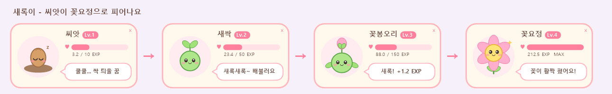

# saerok-tamagotchi

Claude Code에서 쓰는 훅 플러그인입니다. 두 가지 기능이 있습니다.

- **답변 완료 알림창**: Claude가 답변을 마치면 화면 가운데에 알림창이 뜹니다.
- **다마고치 '새록이'**: Claude가 쓴 출력 토큰을 먹고 자라는 캐릭터가 화면 오른쪽 아래에 항상 떠 있습니다.



## 요구 사항

- Windows 10 이상
- PowerShell 7 (`pwsh`)
  - 설치되어 있지 않다면: `winget install Microsoft.PowerShell`

macOS와 Linux에서는 아무 동작도 하지 않습니다.

## 설치

Claude Code에서 아래 두 명령을 입력합니다.

```
/plugin marketplace add hxxdll/token-hook
/plugin install saerok-tamagotchi@saerok-tamagotchi
```

설치한 뒤 Claude Code를 다시 시작하면 적용됩니다.

## 사용 방법

따로 실행할 것은 없습니다. Claude Code를 평소처럼 쓰면 됩니다.

### 답변 완료 알림창

- 답변이 끝날 때마다 화면 가운데에 알림창이 뜹니다.
- 확인 버튼이나 Enter, Esc를 누르면 닫힙니다.

### 다마고치 '새록이'

- 세션을 시작하면 화면 오른쪽 아래에 위젯이 뜹니다.
- 마우스로 끌어서 옮길 수 있고, × 버튼으로 닫을 수 있습니다. 닫아도 다음 답변이 끝나면 다시 뜹니다.

**경험치**: Claude가 쓴 출력 토큰 1,000개가 1 EXP입니다. 답변이 끝날 때마다 새로 쓴 만큼만 더해집니다.

| 단계 | 이름 | 필요 EXP |
|---|---|---|
| Lv.1 | 씨앗 | 0 |
| Lv.2 | 새싹 | 10 |
| Lv.3 | 꽃봉오리 | 50 |
| Lv.4 | 꽃요정 | 150 |

**기분**: 마지막 답변 이후 시간이 지날수록 말풍선이 바뀝니다.

| 지난 시간 | 말풍선 |
|---|---|
| 6시간 미만 | 새록새록~ 배불러요 |
| 6~24시간 | 새록~ 심심해요 |
| 24~72시간 | 새록... 목말라요... |
| 72시간 이상 | 시들기 직전... |

## 기록 위치와 초기화

키우는 기록은 `tamagotchi.json` 파일에 저장됩니다. 저장 위치는 Claude Code가 이 플러그인에 주는 데이터 폴더이고, 그 폴더를 받지 못하면 `~/.claude/saerok-tamagotchi/`에 저장합니다.

처음부터 다시 키우려면 위젯을 닫고 이 파일을 지우면 됩니다.

## 제거

```
/plugin uninstall saerok-tamagotchi@saerok-tamagotchi
```

## 구조

```
.claude-plugin/marketplace.json          마켓플레이스 정보
plugins/saerok-tamagotchi/
├─ .claude-plugin/plugin.json            플러그인 정보
├─ hooks/hooks.json                      Stop, SessionStart 훅 등록
└─ scripts/
   ├─ done-popup.ps1                     답변 완료 알림창
   └─ tamagotchi.ps1                     경험치 계산(-Feed), 위젯 실행(-Ensure), 위젯(-Widget)
```
